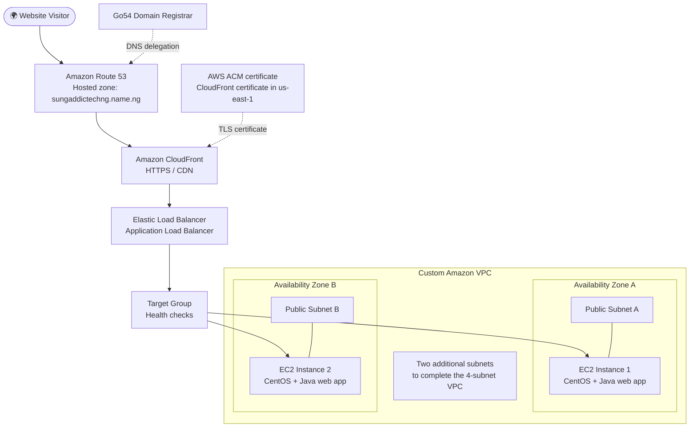

☁️ AWS Cloud Hosting & High Availability Project
Deploying a Java Web Application on AWS with a Custom VPC, ELB, Route 53, ACM & CloudFront

  
  
  
  

A practical cloud deployment project demonstrating secure web delivery, load balancing, and multi-AZ infrastructure on Amazon Web Services.

🌈 Project Overview
This project deploys a Java web application packaged as a WAR file to two CentOS-based Amazon EC2 instances. The infrastructure uses a custom Amazon VPC with four subnets across two Availability Zones, an Elastic Load Balancer (ELB), a target group, Amazon Route 53, AWS Certificate Manager (ACM), and Amazon CloudFront.
The domain is registered with Go54 and the Route 53 hosted zone is intended to manage DNS for:
sungaddictechng.name.ng
Application note: The supplied mercury.war contains JSP/Java web application files and a GlassFish deployment descriptor with the context root /EasyWashCS. Confirm the application server and deployment requirements before deploying it; a WAR file is not a static website.

🏗️ AWS Architecture

🔁 Request flow
1. A visitor opens https://sungaddictechng.name.ng.
2. DNS is managed by Amazon Route 53; the domain remains registered through Go54.
3. CloudFront receives the request and provides HTTPS delivery using an ACM certificate.
4. CloudFront forwards requests to the configured origin, the Application Load Balancer.
5. The load balancer routes requests to healthy EC2 targets in the target group.
6. Both CentOS instances run the application, providing capacity across two Availability Zones.
Important: This is the intended traffic flow. Confirm the CloudFront origin, Route 53 records, target health, and certificates in your AWS account to verify the live deployment. CloudFront must be configured to forward dynamic application requests and required cookies/headers/query strings correctly for the application.
🧰 Services & Components
Component	Purpose
Amazon VPC	Isolated network for AWS resources
4 subnets / 2 Availability Zones	Network segmentation and multi-AZ layout
Amazon EC2 + CentOS	Two compute instances hosting the application
Elastic Load Balancer (ALB)	Distributes incoming requests across healthy targets
Target Group	Registers instances and performs health checks
Go54	Domain registrar
Amazon Route 53	DNS hosted zone for sungaddictechng.name.ng
AWS Certificate Manager (ACM)	Manages TLS certificates for HTTPS
Amazon CloudFront	CDN and HTTPS entry point
Java WAR application	Web application package supplied as mercury.war

🌐 Network Design
The VPC contains four subnets spread across two Availability Zones. The two application instances are placed as follows:
Resource	Placement
EC2 Instance 1	Public Subnet A — Availability Zone A
EC2 Instance 2	Public Subnet B — Availability Zone B
Remaining subnets	Complete the four-subnet VPC design; document their exact roles and route tables in your AWS diagram

For a production deployment, consider putting the application instances in private subnets and keeping the load balancer in public subnets. If you retain public instances for this lab, restrict inbound access through security groups and avoid exposing SSH to the whole internet.
🔐 HTTPS, Domain & DNS
- Domain: sungaddictechng.name.ng
- Registrar: Go54
- DNS service: Amazon Route 53
- CDN / edge entry point: Amazon CloudFront
- TLS certificates: AWS Certificate Manager
Certificate reminders
- CloudFront requires its ACM certificate to be issued in US East (N. Virginia) — us-east-1.
- If the ALB also terminates HTTPS, its ACM certificate must be in the same AWS Region as the ALB.
- Create the relevant Route 53 alias record pointing the domain to the CloudFront distribution.
- At Go54, configure the domain's authoritative name servers to the four name servers assigned to the Route 53 hosted zone. DNS changes can take time to propagate.
- Choose and configure one canonical hostname (sungaddictechng.name.ng or www.sungaddictechng.name.ng) and redirect the other if required.
🚀 Deployment Checklist
Use this as a project checklist and update it with the actual commands, ports, and values from your environment.
- [ ] Create a custom VPC and four subnets across two Availability Zones.
- [ ] Configure route tables, internet access where needed, and security groups.
- [ ] Launch two CentOS EC2 instances in Public Subnet A and Public Subnet B.
- [ ] Install and configure the Java runtime and compatible application server (GlassFish is suggested by the supplied deployment descriptor; verify compatibility before choosing a server).
- [ ] Deploy mercury.war and verify the application context /EasyWashCS.
- [ ] Create an Application Load Balancer and target group.
- [ ] Register both instances and configure a health-check path that returns a successful response.
- [ ] Verify both targets are healthy and test load balancing.
- [ ] Create a Route 53 hosted zone for sungaddictechng.name.ng.
- [ ] Update Go54 nameservers to the Route 53 hosted-zone nameservers.
- [ ] Request/validate an ACM certificate for CloudFront in us-east-1.
- [ ] Configure CloudFront with the ALB as its origin and attach the certificate and domain.
- [ ] Add the Route 53 alias record to CloudFront.
- [ ] Test HTTP-to-HTTPS behavior, application login/workflows, target failure behavior, and DNS resolution.
🛡️ Security & Reliability Considerations
- Allow inbound application traffic to the EC2 instances only from the ALB security group wherever possible.
- Restrict SSH (port 22) to a trusted IP or use AWS Systems Manager Session Manager.
- Use least-privilege IAM roles; do not put access keys, passwords, database credentials, or private keys in GitHub.
- Keep CentOS packages, Java, and the application server patched. Confirm the support status of the CentOS release being used.
- Configure CloudFront origin access controls only for supported origins; an ALB origin is secured differently from an S3 origin.
- Enable ALB access logs and relevant CloudFront logs; consider CloudWatch alarms for unhealthy targets, high error rates, and instance health.
- Keep application secrets and environment-specific configuration outside the repository.
- A multi-AZ design improves resilience, but it does not by itself guarantee high availability: health checks, capacity, application state, database dependencies, and deployment consistency also matter.
🧪 Validation
After deployment, verify:
- [ ] sungaddictechng.name.ng resolves to the CloudFront distribution.
- [ ] HTTPS presents a valid certificate for the requested hostname.
- [ ] CloudFront can reach the ALB origin.
- [ ] Both EC2 instances show Healthy in the target group.
- [ ] The application works through the domain, including its /EasyWashCS context if applicable.
- [ ] The site continues responding if one target becomes unhealthy.
- [ ] No credentials or private keys are committed to the repository.
📁 Repository Contents
.
├── README.md
└── mercury.war       # Java web application package supplied for deployment
Add any deployment scripts, screenshots, sanitized architecture diagrams, or configuration examples that you want to publish. Never commit secrets, private keys, or real credentials.
📚 What This Project Demonstrates
- Building a custom AWS VPC with subnet segmentation
- Deploying an application on CentOS EC2 instances
- Configuring an ELB and target group health checks
- Designing across two Availability Zones
- Managing a custom domain with Route 53 and Go54
- Enabling HTTPS using ACM and CloudFront
- Documenting cloud architecture, security, and validation steps

Built as a hands-on AWS cloud engineering project ☁️
Remember to replace any planned configuration in this README with verified values from your own AWS environment before describing the deployment as production-ready.

